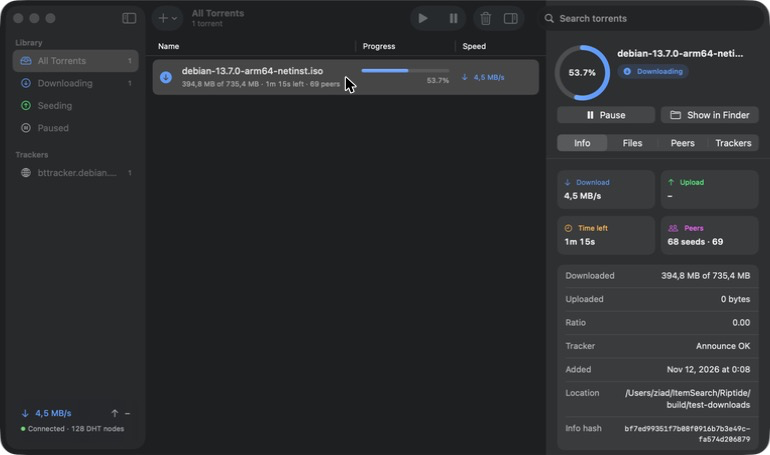
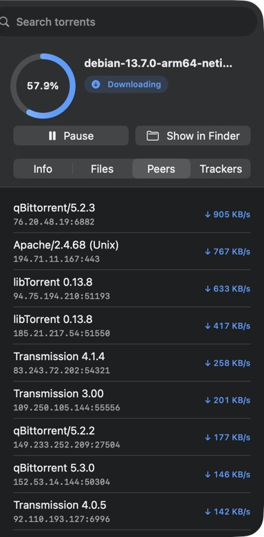

<p align="center">
  
</p>

<h1 align="center">Riptide</h1>

<p align="center">
  A fast, native BitTorrent client for macOS, built with SwiftUI on top of <a href="https://www.libtorrent.org">libtorrent</a>.
</p>

<p align="center">
  
  
  
  
</p>

<p align="center">
  
</p>

## Features

- **Everything you'd expect from a torrent client.** `.torrent` files and magnet links, trackers, DHT,
  peer exchange, local peer discovery, UPnP/NAT-PMP port mapping and web seeds, all powered by
  libtorrent-rasterbar 2.1 (the same engine as Deluge and qBittorrent).
- **A clean, native interface.** Two-line rows show what matters ("394 MB of 735 MB · 1m left · 69 peers"),
  with slim progress bars, live speeds and colour-coded states that adapt to light and dark mode.
- **Inspector.** Progress ring, pause/resume, stat tiles and Info / Files / Peers / Trackers tabs. Choose
  per-file priorities (skip, normal, high) and see which peers you're downloading from.
- **Powerful search.** Type comma-separated keywords; every keyword must match, and each can match the
  name, state, any tracker, the info hash, the tracker status or any file inside the torrent.
  `iso, seeding, debian.org` finds seeding torrents from Debian's tracker containing an `.iso`.
- **Sidebar filters** by state and by tracker, with live counts, plus a transfer and DHT status summary.
- **Picks up where it left off.** Every torrent and its progress is saved (on quit, on completion and
  every two minutes) and restored on launch.
- **Fits into macOS.** Drag and drop `.torrent` files, click magnet links in your browser, Show in Finder,
  copy magnet links, keyboard shortcuts (⌘O, ⇧⌘M, ⌫) and a tabbed Settings window for download folder,
  speed limits and listening port.

<p align="center">
  
</p>

## Install

Download `Riptide.zip` from the [latest release](../../releases/latest), unzip it and move
**Riptide.app** to Applications. The app bundles libtorrent and OpenSSL, so nothing else is needed.
Requires macOS 26 on Apple silicon.

Riptide is signed ad hoc rather than with an Apple Developer ID, so the first time you open it macOS
will block it. Right-click the app, choose **Open**, then confirm, or allow it under
**System Settings → Privacy & Security**.

## Build from source

Requirements: macOS 26, the Xcode Command Line Tools and [Homebrew](https://brew.sh).

```bash
brew install libtorrent-rasterbar dylibbundler
./build.sh                 # runs the search tests, then builds build/Riptide.app
open build/Riptide.app
```

Optional live test, which downloads a few MB of Debian's official installer, then pauses, resumes and
removes it:

```bash
./test-live.sh
```

## How it works

```
SwiftUI views ──▶ TorrentStore (polls once a second) ──▶ RTSession (Objective-C++) ──▶ libtorrent
```

| Path | What |
|---|---|
| `Sources/Bridge/TorrentBridge.{h,mm}` | Thin Objective-C++ wrapper around a `lt::session`: adding, status, alerts, resume data |
| `Sources/App/TorrentStore.swift` | App state, actions, filtering and settings |
| `Sources/App/Search.swift` | Keyword search and type-ahead |
| `Sources/App/ContentView.swift`, `InspectorView.swift`, `SettingsView.swift` | The interface |
| `Sources/App/Theme.swift` | Brand colours, state icons, progress bar and ring |
| `Resources/Icon/make_icon.swift` | Draws the app icon with Core Graphics |
| `Tests/Search`, `Tests/Bridge` | Search unit tests and a live libtorrent smoke test |

App data lives in `~/Library/Application Support/Riptide/state`: one `.resume` file per torrent plus
`session.state` (DHT routing table).

To redraw the icon after editing `Resources/Icon/make_icon.swift`:

```bash
swift Resources/Icon/make_icon.swift /tmp/icon.png 1024 && mkdir -p /tmp/AppIcon.iconset && \
for s in 16 32 128 256 512; do sips -z $s $s /tmp/icon.png --out /tmp/AppIcon.iconset/icon_${s}x${s}.png; \
sips -z $((s*2)) $((s*2)) /tmp/icon.png --out /tmp/AppIcon.iconset/icon_${s}x${s}@2x.png; done && \
iconutil -c icns /tmp/AppIcon.iconset -o Resources/AppIcon.icns
```

### Where the search design comes from

The search behaviour was modelled on Deluge's. Its `FilterManager` registers a `keyword` filter that
splits the query on commas, lower-cases it and narrows the result one keyword at a time, matching each
torrent's name, state, tracker, hash, tracker status and file paths. Riptide keeps that design and fixes
a few edge cases: it trims spaces around keywords, ignores empty ones, checks every tracker rather than
only the first, and matches tracker URLs without regard to case.

## Versions

- **2.0**: app icon, redesigned interface with inspector, dark-mode colours
- **1.0**: first release, table-based interface

## License

Riptide is released under the [MIT License](LICENSE). Bundled libraries keep their own licenses.

## Credits

- [libtorrent-rasterbar](https://www.libtorrent.org) (BSD-3-Clause) by Arvid Norberg and contributors
- [OpenSSL](https://www.openssl.org) (Apache-2.0)
- [Deluge](https://deluge-torrent.org), whose search design inspired Riptide's

Please only download and share content you have the right to.
